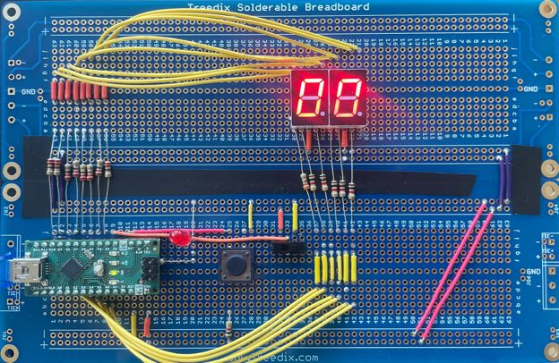
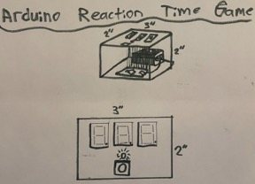
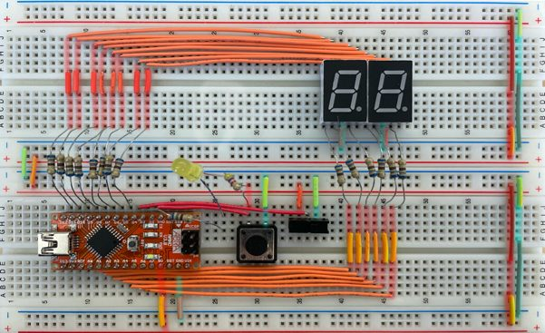
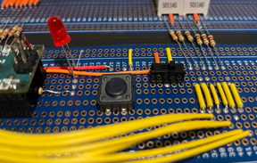
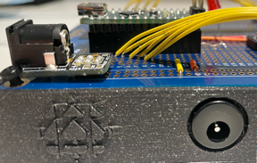

# Arduino Nano Reaction Game

A handheld reaction-time game built on an Arduino Nano. A red LED signals "go", the player hits a button as fast as possible, and their score is shown on seven-segment displays.

<p align="center">
  
</p>


## Overview

The project covers the core ideas of digital electronics: **signal generation, timing measurement and display output**. The inspiration was the Human Benchmark reaction test. The game waits a random 5-10 second delay, lights the LED, measures how long the player takes to press the button (`millis()`) and converts that time into a score.

**Design notes**

- The final score is a value from **1 to 20** rather than raw milliseconds, which fits the two-digit display and keeps the game readable.
- The initial blueprint used three seven-segment displays; the built version uses two digits.
- Seven-segment segments are driven through current-limiting resistors straight from the Nano's I/O pins.

## Development stages

1. **Blueprints.** A hand sketch of the enclosure (3 in x 2 in), display layout and controls, plus a 3D model of the case.
2. **Breadboard circuit.** Placed the Nano and displays first, then wired resistors, the LED, the button and the slide switch.
3. **Final PCB.** Rebuilt on a solderable breadboard and soldered into a finished, battery-powered unit with a 9 V supply and power jack.

## Gallery

| Blueprint sketch | Breadboard prototype |
|:---:|:---:|
|  |  |

| Soldered build detail | Enclosure and power jack |
|:---:|:---:|
|  |  |

## Repository layout

```
arduino-reaction-game/
├── firmware/arduino_reaction_game/   # Game sketch
├── docs/images/                      # Blueprint and build photos
├── LICENSE
└── README.md
```

## Build and run

1. Open `firmware/arduino_reaction_game/arduino_reaction_game.ino` in the Arduino IDE.
2. Select **Arduino Nano**, then upload.
3. Wire the displays, LED and button as defined by the pin constants at the top of the sketch.

## What I learned

- Driving seven-segment displays and managing many I/O pins on a Nano
- Timing with `millis()` and mapping a measurement onto a score scale
- Going from sketch to breadboard to a soldered, enclosed device

## Credits and notes

Created as a Computer Engineering course project (2024). MIT licensed.
